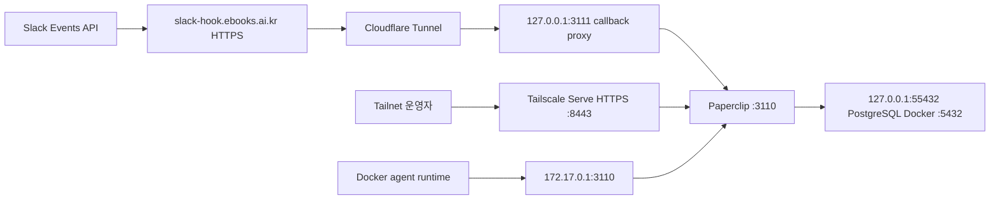

# 현재 배포 구성

확인 시각: 2026-11-16 약 21:38 KST. 복구 후 실측이며 이후 상태는 운영 명령으로 다시 확인한다.

## 연결 경로



## 서비스 목록

| 구성요소 | 관리자/이름 | 확인 상태 | 실행·복구 특성 |
|---|---|---|---|
| Paperclip | 사용자 systemd `paperclipai.service` | active, enabled | `Restart=always`, 5초, `Type=notify`, 중지 제한 300초 |
| Slack 프록시 | 사용자 systemd `paperclip-slack-callback.service` | active | `Restart=on-failure`, 5초, `After=paperclipai.service`, 중지 제한 35초 |
| PostgreSQL | Docker `paperclip-private-slack-db-1` | healthy | `postgres:17-alpine`, `unless-stopped` |
| Cloudflare | 시스템 systemd `cloudflared.service` | active, enabled | `Restart=on-failure`, 5초, token-file 기반 |
| Docker | 시스템 systemd `docker.service` | active, enabled | DB 컨테이너 실행 기반 |
| Tailscale | 시스템 systemd `tailscaled.service` | enabled, Serve 설정 확인 | tailnet 전용 UI 프록시 |
| 사용자 서비스 지속 | `loginctl show-user gabriel` | `Linger=yes` | 로그아웃 후 사용자 서비스 유지 |

Paperclip health는 `status=ok`, `bootstrapStatus=ready`, `databaseBackup.status=ok`이며 UI `/`는 HTTP 200이었다.
현재 checkout SHA: `2a8e2e2da0f2014fac0f3582508c0ad4383cc868`.
런타임은 source CLI와 사전 빌드된 UI/패키지를 함께 사용하므로 checkout SHA만으로 모든 빌드 산출물 버전을 증명할 수 없다.

## 도메인·노출 범위

| 용도 | 주소 | 원본 |
|---|---|---|
| 공개 Slack 수신 | `https://slack-hook.ebooks.ai.kr` | Cloudflare → `http://localhost:3111` |
| 비공개 운영 UI | `https://gabriel-hp-elitebook-850-g7.tail35aacf.ts.net:8443` | Tailscale Serve → `http://127.0.0.1:3110` |
| 컨테이너 에이전트 API | `http://172.17.0.1:3110` | Docker host gateway |
| 로컬 health | `http://127.0.0.1:3110/api/health` | Paperclip 직접 |

Cloudflare 프록시 DNS의 A/AAAA 해석을 확인했다. 실제 DNS 레코드 유형·터널 ID·Access 정책은 Cloudflare 관리 화면에서 별도로 확인해야 한다.
공개 도메인 `/`의 HTTP 404는 정상이다. 이는 전체 Slack 서명 이벤트의 성공 증거는 아니다.
Tailscale Serve 기본 443은 다른 앱의 `localhost:8129`를 향하므로 변경하지 않는다. Paperclip은 8443이며 현재 Funnel 공개가 아닌 tailnet 전용이다.

**Cloudflare 실행 설정 주의:** 현재 unit은 `/usr/bin/cloudflared --no-autoupdate tunnel run --token-file /etc/cloudflared/token`이다.
실행 로그의 원격 ingress는 `slack-hook.ebooks.ai.kr` → `http://localhost:3111`, 나머지는 `http_status:404`이다.
`/etc/cloudflared/config.yml`에는 다른 news 서비스의 과거 설정이 남아 있다. 이 파일을 현재 Paperclip 터널의 원본으로 사용하지 않는다.
Cloudflare 토큰과 Slack 설정/서명 비밀의 값은 이 문서에 기록하지 않는다.

## 포트와 네트워크

| 포트 | 바인딩 | 설명 |
|---|---|---|
| 3110 | `0.0.0.0` | API 및 정적 UI. 호스트 네트워크에 노출되므로 접근 범위는 방화벽/네트워크 정책도 확인 |
| 3111 | `127.0.0.1` | Slack 전용 프록시 |
| 55432 | `127.0.0.1` | PostgreSQL host port → 컨테이너 5432 |

프록시는 `POST /api/chat-webhooks/<publicId>/slack`만 전달하며 나머지는 404이다.
원문 body와 Slack 서명 헤더를 보존하고, 요청 크기는 1 MiB, upstream timeout은 30초다.
Slack 서명 검증은 Paperclip이 담당한다. 프록시는 서명 없는 이벤트를 인증된 이벤트로 바꾸지 않는다.

## 실행·설정·데이터 위치

| 항목 | 현재 위치 |
|---|---|
| 저장소 | `/home/gabriel/agent/prj-agent/development/paperclip` |
| 사용자 unit | `~/.config/systemd/user/paperclipai.service` |
| PATH drop-in | `~/.config/systemd/user/paperclipai.service.d/20-opencode-path.conf` |
| 콜백 unit | `~/.config/systemd/user/paperclip-slack-callback.service` |
| 런처 | `scripts/local-service/launcher` → `entry.mjs` → source CLI |
| 고정 Node 경로 파일 | `~/.config/paperclip/local-service/node-path` |
| 현재 Node | `/home/gabriel/.nvm/versions/node/v24.15.0/bin/node` |
| private env | `~/.config/paperclip/local-service/runtime.env` |
| PAPERCLIP_HOME | `/home/gabriel/.local/share/paperclip-devel` |
| instance | `default` |
| config | `$PAPERCLIP_HOME/instances/default/config.json` |
| 앱 로그 위치 | `$PAPERCLIP_HOME/instances/default/logs` 및 사용자 journal |
| DB Compose | `docker/docker-compose.private-slack.yml` + `docker/docker-compose.local-service.yml` |
| Compose project | `paperclip-private-slack` |
| Compose private env | `docker/.env.private-slack` |
| 현재 DB 볼륨 | `paperclip-private-slack_pgdata` |
| Cloudflare unit/token | `/etc/systemd/system/cloudflared.service`, `/etc/cloudflared/token` |

`entry.mjs`는 config와 env의 DB 연결 문자열 및 포트가 일치하는지 검사한다.
`run --no-repair`, 정적 UI(`SERVE_UI=true`, `PAPERCLIP_UI_DEV_MIDDLEWARE=false`)를 사용한다.
필수 빌드: `server/ui-dist/index.html`, plugin SDK dist, runner dist 및 runnerd.
현재 host HOME이 앱 데이터 원본이다. Compose가 생성하는 `paperclip-private-slack_paperclip-data`는 현재 host 서비스의 데이터 원본이 아니다.

비밀이 아닌 env 주요 값:

```dotenv
PAPERCLIP_DEPLOYMENT_MODE=authenticated
PAPERCLIP_DEPLOYMENT_EXPOSURE=private
PAPERCLIP_BIND=lan
HOST=0.0.0.0
PORT=3110
TZ=Asia/Seoul
PAPERCLIP_PUBLIC_URL=https://gabriel-hp-elitebook-850-g7.tail35aacf.ts.net:8443
PAPERCLIP_API_URL=http://172.17.0.1:3110
PAPERCLIP_CHAT_WEBHOOK_PUBLIC_URL=https://slack-hook.ebooks.ai.kr
PAPERCLIP_ALLOWED_HOSTNAMES=slack-hook.ebooks.ai.kr,192.168.219.125,172.17.0.1
BETTER_AUTH_TRUSTED_ORIGINS=http://localhost:3110,http://127.0.0.1:3110
```

DB는 DB명/사용자 `paperclip`, 주소 `127.0.0.1:55432`이며 비밀번호는 private env에 있다.
`BETTER_AUTH_SECRET`, `PAPERCLIP_TOOL_ACTION_SIGNING_SECRET`, `PAPERCLIP_AGENT_JWT_SECRET`, 암호화 master key와 Slack 자격증명은 보호된 원본에서 보존한다. 마이그레이션 때 임의 재생성하지 않는다.

## 자동 백업과 2026-11-16 복구 기록

자동 DB 백업은 Paperclip 서버 내부 기능이며 별도 cron/에이전트 작업이 아니다.
현재 60분 간격, 7일 보관, 설정 출처 `instance-settings-db`.
저장 위치: `$PAPERCLIP_HOME/instances/default/data/backups/paperclip-YYYYMMDD-HHMMSS.sql.gz`.
서버 중지 중에는 서버의 주기 백업도 실행되지 않는다. 로컬 보관은 호스트 유실에 대한 별도 저장소 백업을 대신하지 않는다.
코드 근거: `server/src/index.ts`, `server/src/services/database-backup-health.ts`, `server/src/routes/instance-database-backups.ts`.

- Slack 이벤트가 21:30~21:31 KST 도착했으나 HTTP 500. DB `127.0.0.1:55432` 연결 거부.
- 당시 DB 컨테이너와 원래 이름의 볼륨이 Docker 목록 및 볼륨 디렉터리에서 확인되지 않았다. 삭제 주체/경위는 미확인.
- 처음 검증한 11월 15일 수동 dump를 복원한 후, 더 최신인 자동 백업을 발견하여 별도 DB에 다시 복원했다.
- 최종 사용 백업: `paperclip-20261116-203146.sql.gz` (2026-11-16 20:31 KST, 파일 완료 약 20:32).
- gzip 검사와 SQL 전체 복원 성공. 회사 1, 에이전트 9, 이슈 135 확인.
- 최종 DB명 `paperclip`. 초기 수동 백업 복원본은 같은 인스턴스의 `paperclip_restored_20261115` DB로 보존.
- DB healthy, health ok/ready, UI 200, 앱/콜백 active 확인. 실제 로그인·Slack 이모티콘/회신은 별도 검증 필요.
- 백업 시점 이후 변경분은 포함되지 않을 수 있다. 복구 SQL 로그: `~/.local/state/paperclip-migration/latest-db-restore.log` (공개 배포 금지).

과거 수동 복구 세트: `~/.local/state/paperclip-migration/` 아래 날짜별 폴더.
DB만 복원하면 HOME 파일과 DB 참조 시점이 다를 수 있다. 첨부파일·agent instructions·자격증명 복호화·skill revision도 실제 사용 시 검증한다.
