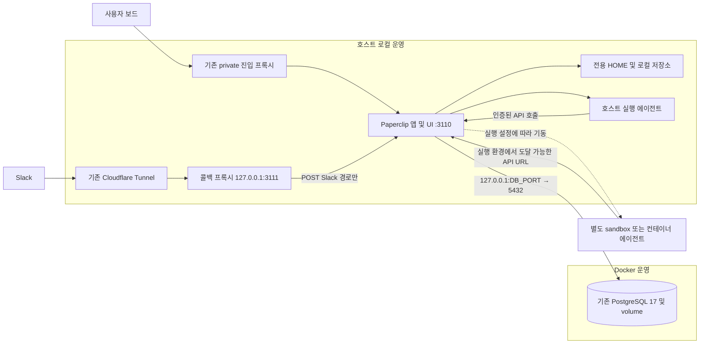

# devel Docker 운영 보존 및 로컬 서비스 전환 계획

## Outcome and scope

이 환경은 한 사람이 사용하는 검증용 개발 환경이다. 현재 `devel` 브랜치와 checkout을 그대로 개발·실행 위치로 사용하고, 별도 시험 앱·복제 DB·임시 instance 없이 Docker 앱에서 로컬 사용자 서비스로 직접 전환한다. 개인 개발 중단 시간은 허용하되 기존 회사·에이전트·Slack·스킬·작업 데이터는 보존한다.

기본안은 **앱을 로컬 사용자 서비스로 전환하고 PostgreSQL은 기존 Docker 컨테이너에 유지**하는 것이다. 현재 Docker 기준 코드는 `devel-docker` 보존 ref와 이미지·설정·데이터 백업으로 남기며, 현재 `devel`의 이름·tracking을 유지한다. 일상 수정과 upstream 반영을 같은 checkout에서 수행하므로 변경 전에 단일 실행 앱을 정지하는 절차를 둔다.

사용자는 앞선 메시지에서 직접 전환을 지시했으며 그 구현 권한은 유지된다. 2026-11-14 후속 요청으로 이 계획의 실제 구현이 승인되었다. 첫 전환과 운영 스크립트를 구현하되 upstream merge·커밋·push는 별도로 수행하지 않는다. 실제 전환 완료와 계획 검토 완료는 구분한다.

Slack·스킬·도구 인증 등 설정별 원본과 로컬 적용·검증 절차는 [Docker 환경 설정 적용 계획](2026-11-13-docker-environment-settings-migration.md)을 따른다. 서비스 정지·최종 동기화·전환·복구의 실행 순서는 이 문서를 기준으로 한다.

## 확인된 현황과 근거

기존 계획에 기록된 2026-11-13 읽기 전용 점검 기준이다. 이번 문서 정리에서는 Git 변경 상태와 관련 파일 존재를 확인했으며, 아래 운영 환경 및 컨테이너 상태를 새로 검증하지 않았다.

- 현재 `devel` HEAD는 `29929f3d2c`, 추적 브랜치는 `fork/devel`이다. 로컬 `devel-docker`는 없다. 원격 존재 여부는 아직 조회하지 않았다.
- `.gitignore`, `AGENTS.md`, Codex adapter, AI connections, Apps UI 등에 미커밋 변경이 있고 `.agentos/`가 미추적 상태다. 이 작업 외 변경을 덮어쓰거나 자동 커밋하지 않는다.
- Compose 프로젝트는 `paperclip-private-slack`, 실행 파일은 `docker/docker-compose.private-slack.yml`, 환경 파일은 `docker/.env.private-slack`이다. 비밀값은 읽거나 문서에 기록하지 않았다.
- 앱은 호스트 `3110` → 컨테이너 `3100`, 콜백 nginx는 `127.0.0.1:3111` → `8080`, DB는 PostgreSQL 17이고 호스트 공개 포트가 없다.
- 앱 볼륨은 `paperclip-private-slack_paperclip-data`이며 `/paperclip`에 마운트된다. DB 볼륨 실제 이름·경로는 구현 전 inspect로 확인한다.
- 콜백 nginx upstream은 `http://server:3100`이다. 앱만 중지하면 이 경로는 끊긴다.
- 후속 읽기 전용 확인(2026-11-14 세션): `docker/.env.private-slack:6`의 `PAPERCLIP_CHAT_WEBHOOK_PUBLIC_URL=https://slack-hook.ebooks.ai.kr`가 실행 앱 컨테이너에도 전달되어 있다. 로컬 서비스에도 동일 값을 명시적으로 주입하고, 기존 Tunnel → `127.0.0.1:3111` 콜백 프록시 → 로컬 앱 `127.0.0.1:3110` 경로를 유지한다. 원본·적용 계약과 운영 확인 근거는 [설정 적용 계획](2026-11-13-docker-environment-settings-migration.md#확인된-slack-콜백-원본과-로컬-적용)에 기록했다. 이 항목은 앞선 과거 점검과 구분되는 후속 확인이며 실제 전환은 미실행이다.
- `cli/src/commands/service.ts`에 `service install/start/stop/restart/status/logs/uninstall`이 있다. Linux는 systemd user, macOS는 launchd를 사용한다.
- `cli/src/services/service-manager.ts`는 `PAPERCLIP_SHIM_PATH` 실행 파일을 `run --instance …`로 실행한다. 기본 shim은 관리형 설치본을 가리킨다. `install --repo --ref`도 원격 커밋 설치이며 현재 작업 디렉터리의 미커밋 수정은 포함하지 않는다.
- `cli/src/onboard-service.ts`는 기존 실행 가능한 custom shim을 허용한다. `cli/src/commands/run.ts`는 소스 체크아웃에서 `server/src/index.ts`를 우선 로드한다. 이 두 경로를 결합하는 아래 설계는 실제 서비스 검증 전까지 제안이다.
- 개발 요구사항은 Node.js 24.11+, pnpm 9+이며 실제 pin은 package manifest와 정책을 우선한다. 후속 사전 조회에서는 Node v24.15.0, pnpm 9.15.4, systemd user 상태 `degraded`, linger `yes`를 확인했다. `degraded`의 실패 unit과 전환 영향은 구현 때 조사한다.

근거 문서: [DEVELOPING](../DEVELOPING.md), [DATABASE](../DATABASE.md), [V1 계약](../SPEC-implementation.md), [Docker 운영](../DOCKER.md). 제품의 회사 경계, 승인, 예산, 감사 기록과 기존 인증 모드는 유지한다.

## Decisions and evidence

### 문서 위치 및 권한

- 단일 계획 원본은 `doc/plans/2026-11-13-devel-local-service-migration.md`다. `AGENTS.md`의 날짜 기반 `doc/plans/` 규칙과 `.agentos/project/project.md`의 프로젝트 규칙 우선 지침을 적용한다. writing-plans의 기본 `.agentos/project/work/` 경로에 중복 계획을 만들지 않는다.
- `.agents/skills/harness/`는 공용 스킬 위치이므로 프로젝트 계획을 저장하지 않는다.
- `status: draft`는 수정된 계획의 검토 상태, `authorization: Implementation authorized`는 앞선 직접 전환 지시를 기록한다. 현재 턴은 계획·QA 범위이며 전환 실행은 미완료다.
- 기존 CLI/service-manager와 UI 빌드 경로를 재사용하는 설계를 유지한다. 구현 단계의 가역적인 상세 선택은 이 계획 범위에서 처리하고, 데이터 유실 허용 범위나 외부 공개 범위 변경 등 중요한 범위 변경은 사용자에게 확인한다.

### 목표 구조와 설계 결정

| 영역 | 전환 후 구조 | 검증해야 할 사항 |
| --- | --- | --- |
| 브랜치 | 기존 `devel`에서 개발·실행·upstream 통합, `devel-docker`는 보존 ref | 기존 tracking 유지, SHA·dirty 변경·이미지 별도 기록 |
| 앱 | systemd user + 소스 checkout launcher | MainPID·명령행·실제 source 경로 일치 |
| 수정 반영 | 서버 소스는 명시적 재시작, 공유 패키지는 필요한 빌드 후 재시작, UI는 빌드 후 재시작 | 수정한 코드가 UI/API에서 관측됨 |
| DB | 기존 PostgreSQL 17 + 호스트 loopback 전용 포트 | 동일 DB/회사/작업 연결, 외부 공개 없음 |
| 데이터 | 전용 호스트 PAPERCLIP_HOME 및 동일 인스턴스 식별자 | 키·첨부·로그·설정 보존, 컨테이너 절대경로 변환 |
| 보드 | 기존 URL 및 3110 유지, 실제 진입 프록시에 맞춘 bind | 로그인·쿠키·origin·접근 경계 |
| Slack | 기존 공용 URL → 제한된 host 콜백 프록시 → 로컬 앱 | 유효한 서명 수신, 서명 오류 거부, 다른 경로 404 |

### 로컬·Docker 운영 영역과 연결 구조

아래는 **전환 후 기본안**이다. 현재 실행 상태를 뜻하지 않는다. Compose와 콜백 설정 파일을 대조했으며, 실제 컨테이너·프록시·에이전트별 배치는 구현 전 조사로 확정한다.

| 구성 요소 | 전환 후 운영 위치 | 역할·보존 대상 |
| --- | --- | --- |
| Paperclip API·스케줄러·연결 처리 | 호스트 로컬 systemd user 서비스 | `devel` checkout에서 실행하는 단일 운영 앱. Slack 수신·응답 처리도 앱이 담당 |
| 보드 UI | 호스트 로컬 앱이 빌드된 정적 파일 제공 | 기존 private URL로 접근하며 앱 포트는 3110 유지 |
| 앱 설정·키·첨부·로그·로컬 스토리지 | 호스트의 전용 `PAPERCLIP_HOME` 및 실제 설정된 저장 경로 | 기존 앱 볼륨에서 최종 동기화. 외부 저장소 사용 시 기존 provider와 접근 설정 유지 |
| Slack 콜백 nginx | 호스트 로컬 서비스가 기본안 | `127.0.0.1:3111` 수신 후 로컬 앱 3110으로 전달. 기존 Docker `slack-callback`은 정지 |
| 보드 진입 프록시·Cloudflare Tunnel | 기존 호스트 측 구성을 유지하는 안 | private 보드 진입과 public Slack 콜백 진입을 각각 연결. 실제 서비스 관리 방식은 조사 필요 |
| PostgreSQL 17 | 기존 Docker `db` 컨테이너와 DB volume | 호스트 loopback 포트만 추가 publish. 기존 데이터·계정 유지 |
| 기존 Docker `server` | 정지 상태로 보존 | 이미지·설정·앱 볼륨을 복구 기준으로 보존. 운영 DB에 로컬 앱과 동시 연결하여 쓰지 않음 |
| 에이전트·Runner·CLI | 에이전트의 기존 실행 설정에 따라 호스트 또는 별도 sandbox/컨테이너 | 앱의 로컬 전환만으로 모든 에이전트를 호스트 실행으로 변경하지 않음. 에이전트별 실행 위치와 API 도달성 확정 |
| n8n 등 별도 서비스 | 기존 배치 유지 | 이번 이전 대상 밖. Paperclip 연결이 있다면 기존 Docker `server` 주소 참조 여부 점검 |



`DB_PORT`는 아직 정하지 않은 호스트 포트다. 에이전트 상자는 선택된 실행 환경을 나타내며, 별도 에이전트 컨테이너가 현재 존재한다고 확인한 것은 아니다. Slack 서비스 자체는 외부 서비스이며, 로컬 앱의 채널 처리 기능과 콜백 프록시가 이를 연결한다.

| 연결 | 주소·설정 계약 | 구현 시 확인할 사항 |
| --- | --- | --- |
| 보드 → 로컬 앱 | 기존 private HTTPS URL → 실제 진입 프록시 → 호스트 3110 | `PAPERCLIP_PUBLIC_URL`, 인증 origin·쿠키 유지. Tailscale/LAN 경로에 맞춰 bind 결정 |
| Slack → 로컬 앱 | 기존 public HTTPS URL → Cloudflare Tunnel → `127.0.0.1:3111` → 로컬 앱 3110 | `/api/chat-webhooks/<endpointId>/slack`의 POST만 전달. 기존 `http://server:3100` upstream 교체, Host·전달 헤더와 서명 검증 유지 |
| 로컬 앱 → Docker DB | `DATABASE_URL` 및 config connectionString → `127.0.0.1:<DB_PORT>/paperclip` → 컨테이너 5432 | Compose 내부 DNS `db`를 호스트에서 사용하지 않음. 비밀번호·DB volume 유지, 외부 DB 포트 공개 금지 |
| 에이전트 → 로컬 앱 | 실행 주체가 접근 가능한 `PAPERCLIP_API_URL` | 호스트 실행은 호스트 도달 주소, 컨테이너 실행은 검증한 host gateway/접근 경로 사용. 컨테이너의 `localhost`는 호스트가 아님. DB loopback publish와 달리 컨테이너 → 앱 경로는 별도 구성 필요 |
| 앱 → Slack API·스킬 소스·모델 provider | 기존 연결·비밀 설정과 outbound HTTPS | DB의 암호화된 자격증명을 기존 키로 복호화하고 서비스 사용자 환경에서 외부 연결 확인 |

컨테이너 콜백 프록시를 유지하는 대안을 선택하면 `slack-callback`의 `depends_on: server`와 upstream을 함께 수정하고, 컨테이너에서 호스트 앱으로 접근할 gateway·bind를 검증한다. 기본안과 동시에 활성화하지 않는다. 보드와 콜백 URL을 에이전트 API 주소와 동일하다고 가정하지 않으며, public 콜백으로 보드나 일반 API를 공개하지 않는다.

### Slack·스킬을 계속 사용하기 위한 이관 범위

Slack은 기존 회사·채널 연결·endpoint ID·암호화된 토큰 및 서명 검증 설정을 보존하고 위 콜백 경로를 전환한다. 동일 public URL을 유지하는 기본안에서는 Slack 측 URL 변경을 요구하지 않지만, 실제 수신·응답까지 검증해야 유지 성공으로 판단한다.

스킬은 별도 상시 서비스가 아니라 앱이 저장·선택하고 에이전트 실행 환경에 제공하는 콘텐츠다. 아래 저장·실행 경로를 함께 보존해야 Docker에서 쓰던 스킬을 이어 사용할 수 있다.

- **Paperclip 관리형·설치형 스킬:** DB의 설치·버전·에이전트 할당 정보와 해당 버전의 실제 콘텐츠 저장소를 함께 보존한다. 로컬 provider는 실제 파일 경로와 권한을 이관하고, 외부 provider는 기존 객체와 접근 설정을 유지한다. 추출 캐시만 복사한 것으로 콘텐츠 보존을 증명하지 않는다.
- **linked-local 스킬·workspace 참조:** 컨테이너의 `/paperclip`, `/app` 등 원본 경로를 호스트 경로 또는 필요한 runtime mount에 명시적으로 대응시킨다. 실제 서비스 사용자와 실행 에이전트가 참조 파일을 읽을 수 있어야 한다.
- **번들 스킬·실행 의존성:** checkout의 skills/assets 빌드·배포 경로를 확인하고, 스킬이 호출하는 CLI·도구·로그인·환경변수를 실제 실행 위치에 준비한다. systemd 서비스가 대화형 셸의 PATH나 CLI 로그인을 자동으로 물려받는다고 가정하지 않는다.

스킬 목록·파일 읽기·할당 버전·대표 스킬 실제 실행을 비교한다. 기존 데이터가 legacy 저장 형식인지는 사전 조사하고, 필요한 경우에만 [스킬 저장 형식 전환 문서](../skill-ephemeral-web-servers.md)의 호환성·변환 절차를 적용한다. 앱 실행 위치 변경만을 이유로 저장소 provider나 스킬 버전을 바꾸지 않는다.

### 단일 devel 개발 환경과 upstream 동기화 원칙

- 추가 checkout·시험 DB·시험 instance·상시 staging을 만들지 않는다. DB/HOME 백업은 유지하고 복원 리허설은 이번 전환의 필수 조건에서 제외한다. 백업의 목록·무결성 검사가 실제 복원 성공을 증명하지 않으므로 복구 시간·복원 가능성은 미검증으로 기록한다. 장애 시 필요해 만드는 복구 대상은 사전 격리 시험 환경과 구분한다.
- `origin`은 upstream `paperclipai/paperclip`, `fork`는 개인 저장소다. 현재 `origin/HEAD`는 `origin/master`다. main이라는 이름을 가정하지 않고 실제 upstream 기본 브랜치를 확인한다. 동기화 기본 대상은 그 기본 브랜치의 fetch 시점 커밋이며 stable 태그와 혼용하지 않는다. stable을 선택할 때는 정확한 태그·SHA를 별도 기록한다.
- 첫 로컬 전환은 보존한 현재 코드로 진행해 실행 위치 변경을 확인한다. 이후 같은 `devel`에서 정기적으로 fetch하고 변경량이 작을 때 upstream을 통합한다. 첫 전환과 upstream 버전 변경을 자동으로 한 번에 묶지 않는다.
- 공유한 `devel`의 이력을 유지하기 위해 기본 통합 방식은 merge다. upstream이 fast-forward 관계면 그대로 진행하고, 분기됐으면 upstream 기본 브랜치를 merge한다. 공유 이력 rebase·force push·`reset --hard`를 정기 절차로 사용하지 않는다. `devel` tracking은 `fork/devel`로 유지하고 upstream ref를 명시해 merge한다. push는 이번 계획 작성에 포함하지 않으며 실행 시에도 기존 권한 범위에서만 한다.
- 호스트 전용 launcher·env example·Compose override·콜백 템플릿은 예를 들어 `scripts/local-service/`, `docker/docker-compose.local-service.yml`에 모은다. 기존 CLI/service-manager와 build 명령을 재사용하며 upstream 핵심 파일에 호스트 경로·도메인·개인 설정을 하드코딩하지 않는다. 비밀·실제 HOME·백업·로그는 Git 추적 경로 밖에 둔다.
- 환경 전환 변경, 기존 제품 기능 수정, upstream merge는 각각 검토 가능한 작은 변경 단위로 관리한다. lockfile은 manifest 변경이 필요할 때만 갱신하고 생성물·vendor를 임의 수정하지 않는다. 충돌 시 개인 override를 다시 적용하고 upstream 기능을 무조건 개인 버전으로 덮어쓰지 않는다.

### 소스 서비스 실행 방식

새 플랫폼 서비스를 만들지 않고 기존 CLI/service-manager를 우선 재사용한다. 프로젝트 전용 executable launcher를 추가하고 `PAPERCLIP_SHIM_PATH`로 지정한다. launcher는 checkout 절대경로로 이동하고, 고정 Node 실행 파일과 로컬 tsx CLI로 `cli/src/index.ts`를 실행하며 전달된 `"$@"`를 보존한다. 환경 파일은 권한 0600으로 별도 관리하고 git에서 제외한다. 예시 구조는 구현 때 실제 경로로 확정한다.

```text
systemd user → project launcher run --instance <기존 instance>
             → 고정 Node + checkout/cli/node_modules/tsx/dist/cli.mjs
             → checkout/cli/src/index.ts → checkout/server/src/index.ts
```

서비스 등록·상태·재시작에서도 같은 `PAPERCLIP_HOME`, instance, shim 설정을 사용한다. generated unit이 셸 환경을 자동 상속한다고 가정하지 않는다. 환경은 launcher 또는 systemd drop-in `EnvironmentFile=`로 명시적으로 주입한다. `service install`의 즉시 시작/로그인 시작 옵션은 구현 시 `--help`와 확인한 옵션으로 지정한다. 로그아웃·부팅 이후 유지가 필요하므로 linger 정책을 확인하고 적용 결과를 기록한다.

상시 운영에는 watch 대신 명시적 재시작을 사용한다. 소스 CLI가 자동 활성화하는 UI dev middleware는 끄고, `SERVE_UI=true` 및 검증된 UI 빌드 경로를 지정한다. `server/src/app.ts`는 `server/ui-dist`를 `ui/dist`보다 먼저 선택한다. UI 갱신은 기존 `pnpm --filter @paperclipai/server prepare:ui-dist`로 두 경로를 동기화하고 실제 제공 파일을 확인한다. `PAPERCLIP_UI_DEV_MIDDLEWARE=false`를 명시하고 build prerequisites는 실행 스크립트에 고정한다. `pnpm build`만으로 모든 workspace runtime import가 실행 가능하다고 가정하지 않는다. 정지 전에는 Runner vendor/binary, plugin SDK, skills/assets와 UI 빌드의 파일·의존성을 정적으로 확인하고, 실제 기동은 기존 Docker 앱 정지·백업 후 같은 devel 환경에서 검증한다. custom shim 방식이 doctor/runtime 정보를 만족하지 못하면 자동 실행을 재개하지 않고 원인을 해결하거나 복구한다. 관리형 npm 설치로 조용히 대체하지 않는다.

일상 개발도 동일 `devel` checkout·기존 DB·전용 HOME을 사용한다. 기본 실행은 위 소스 서비스와 명시적 재시작이다. watch/HMR이 필요해 `pnpm dev`를 사용할 때는 systemd 앱을 먼저 정지하고 같은 DB·HOME·포트·instance·인증 환경을 명시적으로 전달해 단 하나의 앱만 실행한다. dev runner의 자동 migration은 시작 전 확인하고 DB/HOME 백업 후 허용한다. 종료 후 dev 자식 프로세스와 포트가 해제됐는지 확인한 뒤 서비스를 재시작한다.

## Approach

### 1. 기준점과 변경 소유권 보존

1. `git status`, HEAD, remote tracking, worktree 목록과 기존 `devel-docker` ref 여부를 확인한다. 미추적·ignored 운영 파일도 비밀값 없이 목록화한다. 이번 요청과 무관한 대량 문서 이동·삭제 및 진행 중 제품 수정을 보존한다.
2. 미커밋 diff와 필요한 미추적 파일을 비공개 백업 위치에 보존하고 귀속을 기록한다. 브랜치 ref는 미커밋 변경을 포함하지 않는다. 통합할 때는 소유자가 확인한 변경만 명시적으로 stage해 작은 커밋으로 정리하거나, 이름과 복원 방법을 기록한 안전한 보관본으로 작업 트리를 비운다. 모든 변경을 일괄 커밋·삭제하지 않는다.
3. 기존 `devel`을 rename하거나 재생성하지 않고 확인한 전환 전 SHA에 `devel-docker` 보존 브랜치를 만든다. 이름 충돌은 덮어쓰지 않고 기존 SHA와 비교해 필요하면 날짜가 붙은 별도 ref를 사용한다. 이미지 digest·Compose 사본·DB/HOME 백업을 함께 남긴다.
4. `devel` tracking은 유지한다. 원격 보존 ref 게시가 필요한 경우 기존 push 권한을 확인한 범위에서만 수행하며, 전환의 필수 단계로 원격 branch rename·삭제·강제 push를 두지 않는다.

완료 증거: 현재 devel·보존 ref SHA, dirty 변경 보관 위치, 이미지·설정·백업 목록. 추가 worktree나 시험 인스턴스는 만들지 않는다.

### 2. 데이터 및 연결 사전 준비

1. 실제 DB volume, DB명, 앱 HOME/instance, 스토리지 provider, 암호화 master key, 세션·도구서명 secret 위치를 확인한다. 설정·로그에 원문 비밀을 남기지 않는다.
2. 현재 운영 상태와 대표 회사/사용자/작업/승인/첨부 ID 및 개수를 기록한다. DB dump 목록·종료 코드와 HOME 백업의 파일 목록·checksum을 검사한다. 기존 첨부·설정의 경로를 기록하며 읽기·복호화는 전환 후 실제 인스턴스에서 확인한다. 별도 DB 복원 리허설은 생략하며 복원 성공을 주장하지 않는다.
3. 기존 Compose를 유지하는 최소 override를 작성·정적 검증하고 DB 포트로 사용하지 않는 `127.0.0.1:<DB_PORT>:5432`에만 publish하도록 계획한다. 여기서는 운영 DB 컨테이너를 재생성하지 않는다. 실제 적용은 4단계에서 앱 정지·최종 백업 후 수행한다. 앱 DATABASE_URL의 `db` 호스트명은 호스트 loopback 주소로 변경한다.
4. 호스트 HOME 디렉터리에 앱 볼륨 데이터를 복사하고 권한을 서비스 사용자에게 맞춘다. CLI `run`은 config가 없으면 onboarding으로 진입하므로 기존 config의 호스트용 사본을 준비하고 명시적으로 선택한다. 복사한 config의 database mode/connectionString과 서버 DATABASE_URL, config server port와 PORT를 동일 대상으로 동기화한다. doctor의 DB 검사는 서버 환경변수 대신 config를 사용할 수 있다. config 부재 시 운영 대상으로 자동 onboarding하지 않고 중단한다. 최초 시작의 doctor repair 동작을 코드·설정으로 먼저 확인하고, 실제 실행은 최종 백업을 확보한 전환 창 안에서 수행한다. 설정·첨부·workspace·키 파일의 `/paperclip`, `/app` 등 절대경로와 컨테이너 네트워크 이름을 점검한다. 임의 전역 치환이나 기존 키 재생성은 금지한다.
5. 위 운영 영역 표를 실제 에이전트·스킬·연결별로 대조하고 호스트 경로 및 runtime mount 대응표를 작성한다. 어댑터 실행 사용자, PATH, 로컬 CLI 로그인, workspace 접근권한, sandbox/Runner 의존성, Docker runtime agent에서 접근하는 API URL을 점검한다. 컨테이너의 localhost는 호스트가 아니므로 호출 주체별 도달성을 검증한다.

### 3. 같은 devel에서 실행 준비와 정적 검증

1. 별도 DB/HOME·임시 포트·다른 instance를 기동하지 않는다. 동일 운영 instance를 사용하되 systemd unit 이름 충돌과 Docker 외 기존 앱 프로세스를 확인한다. 실행 명령을 확인하는 과정에서도 운영 DB를 사용하는 두 번째 앱을 띄우지 않는다.
2. source launcher, 설치/상태/로그/중지/재시작 wrapper, 비밀 없는 env example, DB-only Compose override, callback 템플릿과 runbook을 위 로컬 전용 경로에 추가한다. 제품/DB schema 변경은 기본 범위 밖이다.
3. 서비스가 실행할 동일 Node/PATH의 버전·workspace build prerequisites 존재 여부와 launcher 구문·프록시 설정을 읽기 전용으로 검사한다. 실제 install/build/test와 실행 앱을 띄우는 doctor는 여기서 수행하지 않는다. 4단계의 신규 실행 차단 → drain·앱 정지 → 최종 백업 → install/build/check → migration → 시작 순서에 합친다.
4. 기존 notify/정상 종료·child 정리 동작을 유지한다. bind와 Tailscale/LAN 도달성, API URL을 정하고, host callback은 3111에서 POST Slack 경로만 로컬 3110으로 전달하도록 준비한다. Docker callback과 동시 포트 사용을 막는다.

정지 전 정적 검사와 전환 후 실제 실행 검사를 구분해 기록한다. 설정·build 실패 시 먼저 해결하며, 정지 후 실패하면 서비스를 닫아둔 상태로 수정하거나 아래 복구 절차를 사용한다.

### 4. 정지·최종 동기화·전환

1. 전환 창을 정하고 신규 자동 실행·웹훅 유입·사용자 쓰기를 중단한다. 활성 run을 drain하고 타임아웃 시 자동 강제 종료하지 말고 중단 원인을 판단한다.
2. 기존 Docker 앱과 callback을 정지한다. 앱 restart policy/자동 배포가 다시 켜지지 않도록 조정한다. DB 및 다른 서비스(n8n 등)는 대상에서 제외한다. `down -v`를 사용하지 않는다.
3. writer 정지 후 최종 DB dump와 HOME 백업을 동일 정지 구간에서 확보하고 최종 복사한다. dump 목록·아카이브 검사 결과·checksum·이미지 digest를 기록하며 복원 리허설은 미실행으로 명시한다. 기존 볼륨은 보존한다. 이 백업 이후 DB-only override를 적용해 loopback 포트를 publish하고 PostgreSQL ready를 확인한다. 재생성된 DB가 동일 volume을 사용하는지 확인한 뒤에만 진행한다.
4. 최종 백업 뒤 같은 devel checkout에서 필요한 install/build/check를 수행하고 Runner·plugin SDK·skills/assets·UI 제공 파일을 준비한다. 통과 후 필요 migration을 한 번만 수행하고 적용 목록을 기록한다. 이전 코드가 변경된 DB를 읽을 수 있다고 가정하지 않는다. doctor·앱의 자동 repair/migration도 이 백업 이후에만 실행한다. 실패하면 자동 기동하지 않고 수정 또는 복구한다.
5. 로컬 서비스를 3110으로 시작하고 기존 URL 로그인·주요 데이터·콜백 경로를 검증한다. 성공 후 자동 실행/웹훅을 한쪽 앱에만 재개한다. Docker 앱과 로컬 앱을 운영 DB의 동시 writer로 실행하지 않는다.

### 5. 인수와 반복 가능한 upstream 업데이트

1. 작업 시작 전 또는 하루 한 번 필요할 때 `git fetch origin --prune --tags`로 원격 ref만 갱신한다. 네트워크 성공 후 `git remote show origin`으로 실제 기본 브랜치를 확인하고, 현재 HEAD·목표 SHA·차이·release note·migration·Node/pnpm 요구사항을 기록한다. 이 과정은 실행 코드를 바꾸지 않으므로 서비스 중에도 가능하다. 자동 merge나 서비스 재시작은 예약하지 않는다.
2. 직접 코드 수정·의존성 설치·merge 전 Slack 유입과 routine·heartbeat 등 신규 실행을 막고 run을 drain한 뒤 로컬 서비스를 정지한다. 같은 checkout을 사용하는 에이전트도 중지된 것을 확인한다. 중단 방법은 지원 API/설정과 프록시 차단을 조합해 확정하고, 원래 재개할 설정 상태를 기록한다.
3. 해당 업데이트 직전의 DB/HOME·env·현재 정상 실행 devel SHA·dirty 변경을 하나의 복구 세트로 백업한다. 사용한 Node/pnpm 버전·lockfile·서비스 설정·UI 및 runtime 산출물의 재생성 방법도 기록한다. 깨끗한 트리에서 기록한 upstream 기본 브랜치의 목표 SHA를 merge하고 충돌을 해결한다. 미커밋 변경을 임시 보관했다면 install/build 전에 다시 적용해 실제 실행할 최종 트리를 검증한다. 자동 stash pop이나 포괄적인 ours/theirs 해결은 하지 않는다.
4. `pnpm install --frozen-lockfile`과 해당 변경 범위의 build/typecheck/test를 수행한다. migration은 백업 후 한 번만 적용하고 이전 코드와의 호환성을 기록한다. 실패 시 자동 기동하지 않으며 Git만 되돌려 변경된 DB에 이전 앱을 연결하지 않는다.
5. 같은 HOME·instance·3110으로 로컬 서비스를 시작하고 health·기존 로그인·첨부·스킬·에이전트·콜백을 검증한다. 자동 실행과 외부 유입의 재개 시점을 기록하고 단일 writer를 확인한다. 완전한 인수 전 필요한 수신 테스트만 제한적으로 허용한다.
6. 서비스 소스 경로·PID, 실행 SHA와 dirty diff 식별 정보, 의존성·migration 적용 목록, 실패·복구 내역을 기록한다. 로그아웃/부팅 시 서비스·DB 자동 시작과 DB 준비 지연 복구도 확인한다.

매번 별도 검증 환경을 만들지 않는다. 코드 수정·merge/install/build 중에는 앱을 정지하고, 실제 여정 검증은 재시작한 단일 개발 인스턴스에서 수행한다. 첫 전환은 현재 코드로 끝내며 첫 upstream merge 시점과 선택 SHA는 별도 업데이트 기록에 남긴다.

## Acceptance evidence

| 시나리오 | 통과 증거 |
| --- | --- |
| 브랜치 보존 | Docker SHA/운영 이미지/로컬 변경 백업 확인, devel tracking 일치 |
| 서비스 실체 | `systemctl --user` MainPID와 source launcher/checkout 경로 일치, 예상 포트 소유자 단일 |
| 보드 접근 | 기존 private URL 로그인, 세션 유지, 비인증 요청 거부 |
| 데이터 보존 | 대표 회사·작업·승인·첨부 및 secret 복호화 정상, 회사 간 접근 거부 |
| agent 실행 | 허용된 최소 실제 작업 1회 완료, 로그·콜백·취소 및 자식 종료 정상 |
| 스킬 보존·실행 | 기존 목록·할당·선택 버전 및 파일 읽기 일치, linked-local 경로 접근과 대표 스킬 실제 실행 성공 |
| 영역 간 연결 | 로컬 앱 → Docker DB, 실제 에이전트 실행 환경 → 로컬 API, 기존 private 보드 및 public 콜백 경로 확인 |
| Slack | 유효 이벤트 1회 처리·응답, 중복 이벤트 중복 작업 없음, 잘못된 서명 거부, 다른 경로 404 |
| 수정 반영 | 작은 임시 소스 변경 후 build/restart로 관측하고 원복 후 재확인 |
| 자동 시작 | 로그아웃/재부팅 후 서비스·DB·프록시 정상, 충돌·이중 scheduler 없음 |
| 백업·복구 준비 | DB dump 목록·HOME 아카이브 무결성, 기준 이미지·설정과 복구 명령 확인. 별도 복원 리허설·소요 시간은 미검증으로 명시 |
| upstream 반영 | 실제 기본 브랜치·목표 SHA·merge 결과·직전 정상 devel 복구 세트와 재시작 후 여정 증거. 첫 전환에서는 미실행으로 별도 표시 |

구현 검증은 관련 CLI service/shim 테스트와 운영 스크립트 검사부터 시작한다. PR-ready 인수 전에는 저장소 규칙대로 `pnpm -r typecheck`, `pnpm test:run`, `pnpm build`를 실행하고 미실행 항목·원인을 기록한다. 실제 여정은 위 인수 시나리오로 검증하며 전체 browser suite는 변경 대상이 될 때만 실행한다. 이번 문서 작업에는 코드 빌드/테스트를 실행하지 않는다.

## 실패 시 복구

복구 기준을 다음처럼 구분한다. 최초 Docker 기준점을 이후 모든 업데이트의 기본 복구 대상으로 사용하지 않는다.

| 실패 시점 | 복구 코드·설정 | 복구 데이터 기준 |
| --- | --- | --- |
| 최초 Docker → 로컬 전환 | 보존 Docker 이미지 digest·Compose·env·앱 볼륨 | 최초 전환 직전의 일관된 DB/HOME 백업 또는 호환성이 확인된 현재 데이터 |
| 이후 devel 수정·upstream 업데이트 | 해당 업데이트 직전 정상 devel SHA·dirty 변경·lockfile·Node/pnpm·서비스/env·UI/runtime 산출물 | 같은 업데이트 직전의 일관된 DB/HOME 백업 또는 호환성이 확인된 현재 데이터 |

1. 로컬 앱·callback·자동 실행을 정지하고 writer가 없는지 확인한다. 실패 시점의 코드·DB/HOME·로그와 외부 동작 내역도 보존한다.
2. schema·저장 형식·파일 변경이 이전 코드와 호환된다는 근거가 있으면 해당 행의 이전 코드/설정으로 돌아간다. 최초 전환은 Docker 기준 이미지, 이후 업데이트는 직전 정상 devel snapshot을 복원한다. 기존 dirty 변경을 무시하는 hard reset은 하지 않는다. 이전 lockfile로 의존성과 UI/runtime 산출물을 재생성·확인한 후 같은 로컬 서비스를 기동한다.
3. schema·스킬 저장 형식 등이 변경됐거나 하위 호환이 불명확하면 해당 행의 DB/HOME 백업을 **새 복구 대상**에 함께 복원한다. 실패 시점 원본은 덮어쓰지 않고, 이전 코드의 DB·storage 설정을 이 복구 대상으로 맞춰 단일 writer로 시작한다. Docker 기준 이미지를 쓸 때도 임의의 최신 DB에 연결하지 않는다. 역방향 migration은 추측하지 않는다.
4. 전환/업데이트 후 신규 쓰기는 복구 전에 보존하고 유실 범위·재처리·중복 외부 동작을 판단한다. 단독 개발이라는 이유로 신규 데이터를 자동 폐기하지 않는다. 데이터 유실이 필요한 복구는 그 범위를 사용자와 합의한다. 복원 리허설을 생략하므로 실제 복원 성공과 소요 시간은 사전 보장하지 않는다.
5. 보드 URL·Slack upstream·방화벽/포트·서비스 자동 시작·컨테이너 restart policy를 선택한 복구 코드에 맞춰 확인하고 이중 실행이 없도록 한다. health·기존 로그인·첨부·스킬·에이전트·콜백 검증 후 저장해 둔 자동 실행/유입 설정을 재개한다. 기준 ref checkout만으로 복구 완료를 선언하지 않는다.

## Current state

- 완료: Git dirty 변경·untracked·Compose/env·container inspect 보관, `devel-docker` ref와 Docker 이미지 태그 생성, 기준 데이터 및 활성 run 조사. `scripts/local-service/`에 source launcher, service wrapper, backup/prepare helper, 제한된 콜백 프록시·테스트·unit 템플릿·env 예제·runbook 추가. DB loopback Compose override 정적 검증 통과.
- 남음: 최종 백업의 무결성·정지 구간 증거 확인, HOME 복사·호스트 경로 대응·인증 이관, install/build/test, DB 포트 적용·migration 검토, 서비스/콜백 설치·시작과 실제 인수 여정. config 작성은 사용자 승인 및 검증 완료. upstream merge와 복원 리허설은 미실행.
- Next concrete action: 실행 중인 로컬 보드에서 기존 에이전트의 `/paperclip` instructions와 workspace·도구 인증 경로를 호스트 경로로 대응하고 대표 실행을 확인한 뒤 자동 실행과 Slack callback을 재개한다.
- 작업물 전달: Paperclip issue 인증 환경이 없어 업로드/work product 등록을 수행하지 않았다. 소스·runbook·상태 기록은 저장소 경로로 제공한다.

## QA 검토 및 반영 기록

검토자 `qa_review`가 서비스 manager, CLI run/doctor, Compose와 대조했다. 높음 2건(동일 checkout 변경 중 운영 위험, instance 기반 unit 충돌), 중간 2건(DB 재생성 시점, config와 환경변수 불일치)을 발견했다. 각각 5단계 업데이트 정지 순서, 3단계 별도 instance, 2/4단계 DB 적용 시점, 2단계 config 동기화로 반영했다. 브랜치 변경 보존·Slack 제한·schema 변경 후 복원에는 추가 중대 발견이 없었다. 이는 계획의 정적 검토이며 실제 전환 성공 증거는 아니다.

과거 QA의 격리 instance 사전 검증 권고는 위 사용자 선택으로 대체됐다. unit 충돌 확인·단일 writer·백업·전환 후 검증은 유지한다.

### 2026-11-14 단일 devel 개발 방식 QA

사용자 요청으로 `qa_local_plan` 에이전트가 두 계획을 읽기 전용으로 검토했다. 반복 upstream 업데이트의 복구 기준이 최초 Docker 기준점과 혼재한 문제, install/build와 최종 백업 순서의 모호함을 발견했다. 최초 전환은 Docker 복구 세트, 이후 업데이트는 직전 정상 devel 코드·의존성·UI·설정·DB/HOME 세트로 분리하고, 정지 → 최종 백업 → install/build/check → migration → 기동으로 수정했다. upstream 인수 항목은 최초 전환과 별도 적용하도록 표시했다. 그 외 사용자 선택과 충돌하는 중대한 발견은 없었다. 이는 정적 계획 리뷰이며 실제 서비스 전환·upstream 동기화·복원 검증 결과는 아니다.

두 문서의 로컬 링크 대상·공백·단일 Next concrete action 및 변경된 실행 순서를 확인했다. 문서 변경만 수행했으므로 코드 빌드·테스트는 실행하지 않았다.


## 2026-11-14 구현 기록

- 구현 시작: `devel`/`fork/devel`, HEAD `29929f3d2cfb96f2ff47a322fcd628651a3768e0` 유지. 같은 SHA에 `devel-docker` 보존 ref 생성.
- 비공개 복구 기준: `~/.local/state/paperclip-migration/20261114-031259/`에 Git binary diff, untracked archive, refs/worktree 목록, 원본 Compose/env/프록시, 비밀 포함 container inspect 보관(0600/0700). 문서 이동·제품 변경은 수정하지 않음.
- Docker 앱 이미지 `sha256:feb51199405e0b6b64fb84e4934f3239a165b1ed6202417d19bbcc525779984b`, DB volume `paperclip-private-slack_pgdata`, 앱 volume `paperclip-private-slack_paperclip-data` 확인.
- 기준 조회: 회사 1, agents 8, issues 98, approvals 0, assets 29, skills 66, skill versions 104. 활성/queued run 0. active routine 1, active Slack endpoint 6. 기존 error agent 2는 이관 전 상태.
- systemd 실패는 기존 Orca scope 3개로 Paperclip unit과 무관. linger=yes. Tailscale 보드 :8443 → 127.0.0.1:3110 유지.
- 발견: Docker 환경의 config 경로에 실제 파일이 없다. 자동 onboarding은 하지 않으며 기존 유효 설정 기반 config 작성 여부를 사용자에게 비동기 질문함. 응답 전 전환·의존성 변경을 보류.
- 호스트 nginx/caddy는 설치되어 있지 않아 동일 제한을 적용하는 Node HTTP 콜백 프록시를 준비한다. 본문 원문 바이트 보존, POST Slack 경로만 허용, 1 MiB 제한, loopback:3111 바인드.
- 준비한 launcher는 checkout 밖의 pinned Node 경로와 0600 runtime.env를 읽고 기존 CLI service manager를 사용한다. config/DB/port 일치·빌드 산출물을 확인하고 run의 자동 repair를 끈다.

- 사전 DB dump `database.preflight.dump`의 pg_restore 목록 검사 성공. 이는 writer 정지 후 최종 백업을 대체하지 않으며 HOME 최종 archive는 아직 없다.
- 실제 실행 앱 health가 보고한 commit은 `7a6f334cf352eaa82d895675259aeaa22b09e70c`로 devel HEAD와 다르다. 해당 commit은 devel의 조상이며 KST 등 이후 devel 변경이 첫 로컬 실행에 포함된다. Docker 원본 코드는 이미지 태그 `paperclip-devel-docker:20261114`/digest로 보존한다. `devel-docker` ref는 요청된 전환 전 devel HEAD를 보존한 것이며 실행 이미지 commit과 혼동하지 않는다.
- 정적 검증: Bash 4개 `bash -n`, Node entry/proxy/test `node --check`, Compose 두 파일 `config --quiet`, 변경 파일 whitespace 검사 통과. 운영 앱이 살아 있으므로 계획의 실행 순서대로 pnpm install/full typecheck/test/build, 콜백·CLI 테스트와 doctor는 실행하지 않음.
- 기존 보드 URL을 Orca 탭으로 열었으나 로그인 화면이며 인증된 세션은 없다. 비밀번호를 요청하거나 DB session을 복제하지 않고 탭에서 사용자 로그인을 요청했다. `computer-use`/`orca-cli` 스킬로 브라우저 가용성을 확인했다.
- 자동 실행/서비스/포트/DB/HOME의 실제 변경은 하지 않았다. Docker 앱·callback·DB 및 n8n은 그대로 실행 중이며 health `ok`, bootstrap `ready`를 재확인했다.

### config 승인 후 실제 상태 재확인

- 사용자가 config 작성과 계속 진행을 승인했다. 앞선 응답의 “config 미작성·Docker 실행 중” 설명은 오래된 계획 기록에 의존했으며 아래 실제 상태로 정정한다.
- 기존 파일 발견: `~/.local/share/paperclip-devel/instances/default/config.json`, `~/.config/paperclip/local-service/runtime.env`, `node-path` (모두 2026-11-14 03:27 생성). 중복 생성하거나 기존 키를 교체하지 않았다.
- 실제 shared config schema와 Node dotenv parser 검증 통과. 디렉터리 0700, 설정 파일 0600, config/env의 PostgreSQL URL 및 앱 3110 일치 확인. 기존 Docker env와 세션·도구 서명·모델 키 및 보드·콜백 origin 일치, agent JWT의 기존 Better Auth fallback 보존 확인. 비밀값은 출력·문서화하지 않았다.
- 관측 시점에 Docker 앱과 callback은 정지, DB는 healthy이나 호스트 공개 포트 없음. 로컬 3110/3111/55432 listener 없음. 이번 재개 턴에서는 컨테이너·서비스를 정지하지 않았다.
- `20261114-0327-final/`에 DB dump·HOME archive·SHA256SUMS·backup-complete가 존재한다. 이번 턴에서는 내용 무결성이나 writer 정지 시점을 아직 재검증하지 않았다.
- 로컬 HOME은 config만 있으며 master.key는 아직 없다. config 준비 완료는 서비스 전환 완료를 뜻하지 않는다. doctor·앱 기동은 데이터 복사와 DB 준비 후 실행한다.

### 로컬 서비스 전환 재개

- Docker 앱·콜백은 03:27 이전에 정지되어 restart policy `no` 유지. 현재 run 0·앱 DB 연결 0을 확인한 후 진행했다. 최종 백업 checksum 4개 모두 재검증 통과.
- HOME archive를 `~/.local/share/paperclip-devel`에 기존 config 제외·기존 파일 덮어쓰기 금지·현재 사용자 소유로 복사 완료(exit 0, 오류 로그 0 bytes). master.key 보존 확인.
- DB-only override 적용: 동일 `paperclip-private-slack_pgdata`, PostgreSQL ready, `127.0.0.1:55432`만 publish. 회사 1·agents 8·issues 98·assets 29 유지. migration inspect `upToDate`; migration 적용 없음.
- frozen install 성공. 첫 전체 typecheck는 이전 문서 이동으로 깨진 map 링크 때문에 실패. 이동된 문서 3개의 map 링크를 수정하고 `node scripts/check-maps.mjs` 통과.
- source launcher 사용 중 다른 instance의 전역 shim이 managed manifest 오류를 일으켜, 명시적 별도 launcher 사용 시 전역 shim만 설치 증거에서 제외하도록 CLI 검사 수정. 해당 store의 manifest/marker/current는 계속 검사한다. 회귀 테스트 5개 통과.
- CLI service install 완료(기동 전). linger=yes 확인. doctor 재검사 11 pass/1 warning/2 fail: 아직 시작하지 않은 서비스 runtime/health만 실패. strict secret mode 비활성화 경고는 기존 설정 유지.
- `HEARTBEAT_SCHEDULER_ENABLED=false`를 private runtime.env에 지정해 첫 기동 자동 실행을 보류. Slack callback 미기동. `/paperclip` instructions 경로가 에이전트에 남아 있어 실제 agent 인수 전 경로 대응 필요.
- prepare 재시도 진행 중: `~/.local/state/paperclip-migration/prepare-retry.log`. 첫 실패는 `prepare.log`, doctor 결과는 `doctor-retry.log`.

### 로컬 앱 기동 결과

- 전체 typecheck 재시도 통과. 전체 test:run은 첫 chat shard가 장시간 실행되어 운영 전환 검증 순서를 조정하며 중단했고 **미완료**로 남긴다. 테스트 전용 prepare 자식 프로세스만 종료; 운영 DB는 유지. PR-ready/전체 인수 완료를 주장하지 않는다.
- 관련 CLI 서비스/managed-install 테스트 5 files·60 tests 통과, callback Node 테스트 1 통과. `pnpm build` exit 0, plugin build dependencies 준비, server UI 배치 exit 0 및 index 비교 통과.
- 2026-11-14 08:43 KST `paperclipai.service` active/running 확인. source launcher로 현재 devel 실행, health `status=ok`, `bootstrapStatus=ready`, authenticated/private, 기존 HEAD `29929f3d2cfb96f2ff47a322fcd628651a3768e0`. Doctor 기동 중 critical checks 통과. 기존 보드 클라이언트의 회사·작업 GET 200 확인.
- Docker 앱/콜백 정지 유지. 로컬 자동 실행 `HEARTBEAT_SCHEDULER_ENABLED=false`, Slack callback 미기동 유지. 에이전트 instructions의 Docker 절대경로 및 CLI 인증/스킬 실사용 인수는 미완료. 로컬 앱 기동과 전체 자동화 복구를 구분한다.
